# Talley — six-camera visual comparison

This report accompanies the photo-informed architecture revision, not the earlier Talley gameplay release. All 38 original photographs were inspected individually. Source photos are private development references and are deliberately not embedded in this repository, public PR media or web assets. The user can compare the filenames below against their original package. Private side-by-side evidence is delivered separately through the session, not deployed.

## Camera checkpoints

The following are actual **5c927ea** game-camera fixtures, not concept renders or gameplay completion evidence. Each reference/story pair has identical position, direction and FOV. Diagnostic screenshots deliberately use **DPR1.0 / 1280×841** for inspection and are watermarked; they are **not native software-renderer quality**. The unmodified framing is retained in the WebP copies. Private original photographs appear only in the separately delivered private comparison PDF.

| Checkpoint / original photograph | In-game neutral reference lighting | In-game story lighting |
| --- | --- | --- |
| A · IMG_1042.JPG | 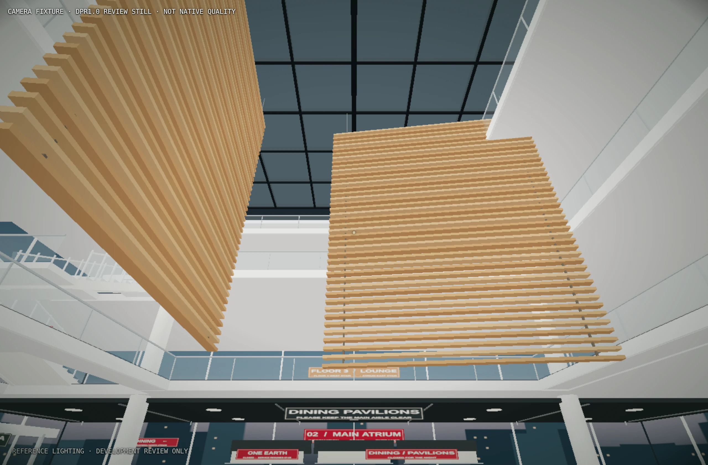 | 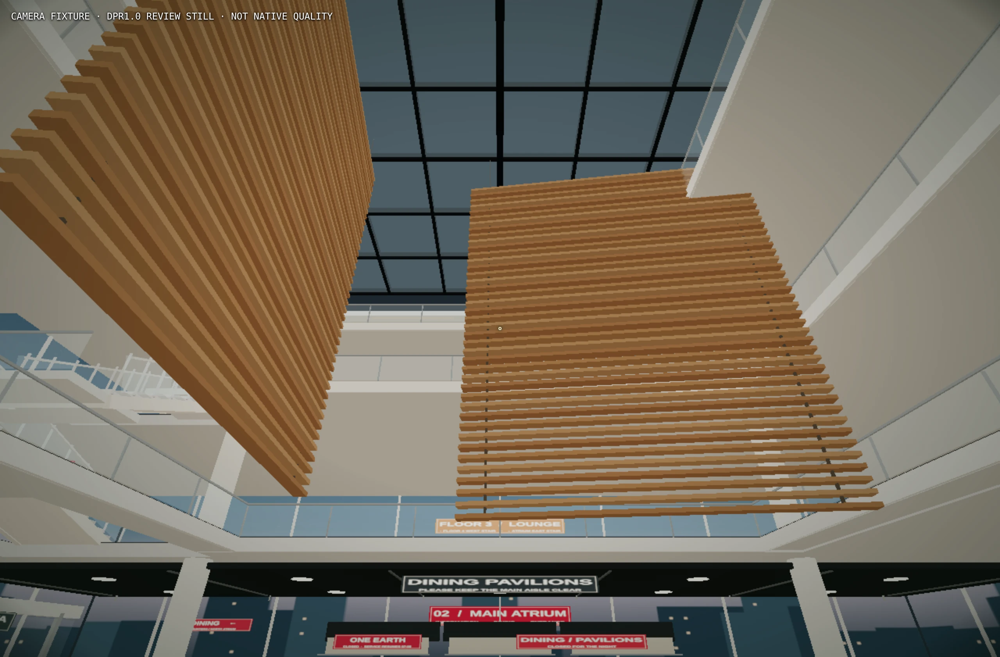 |
| B · IMG_1047.JPG | 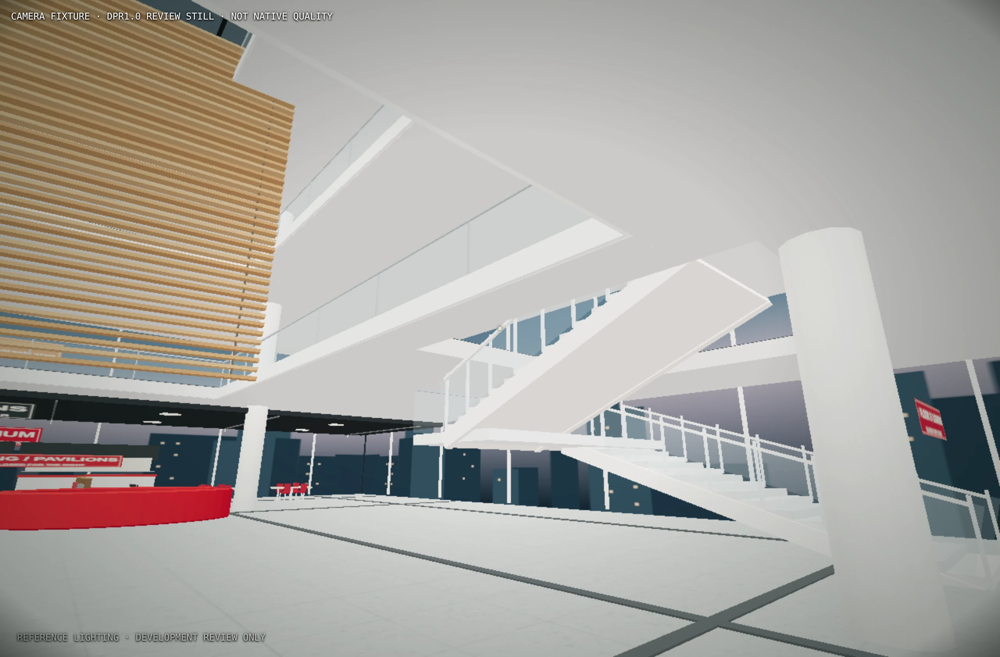 | 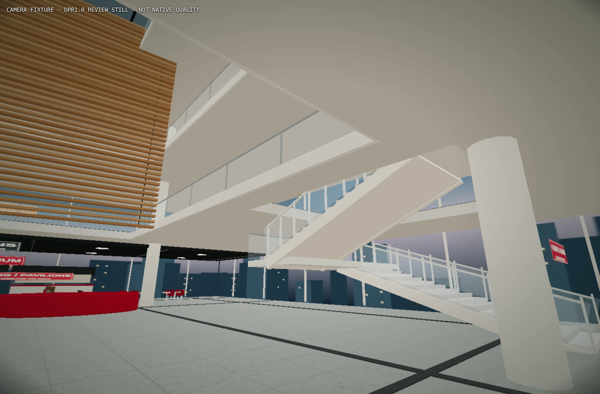 |
| C · IMG_1045.JPG; also IMG_1041.JPG | 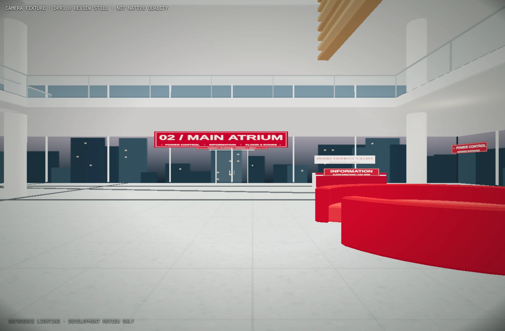 | 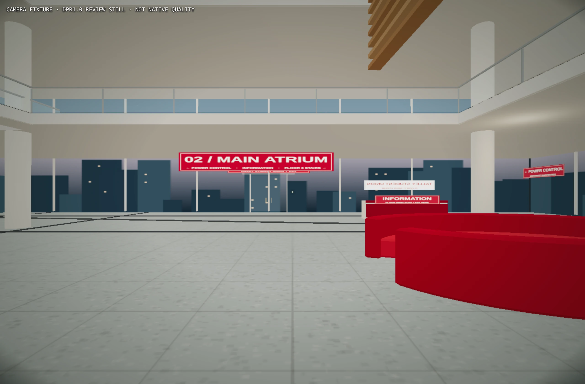 |
| D · IMG_1034.JPG; also IMG_1035.JPG | 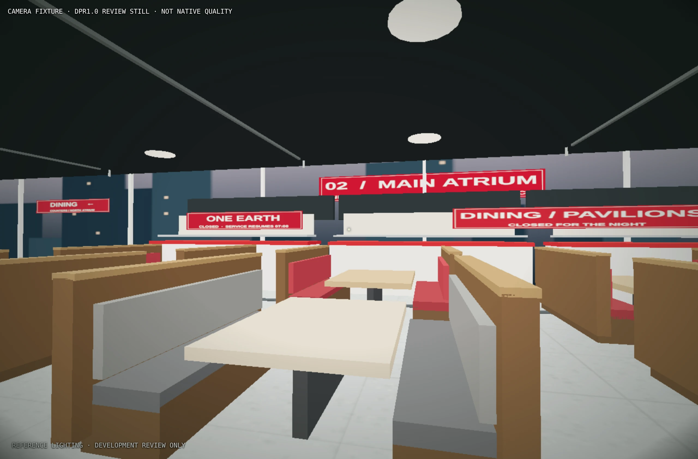 | 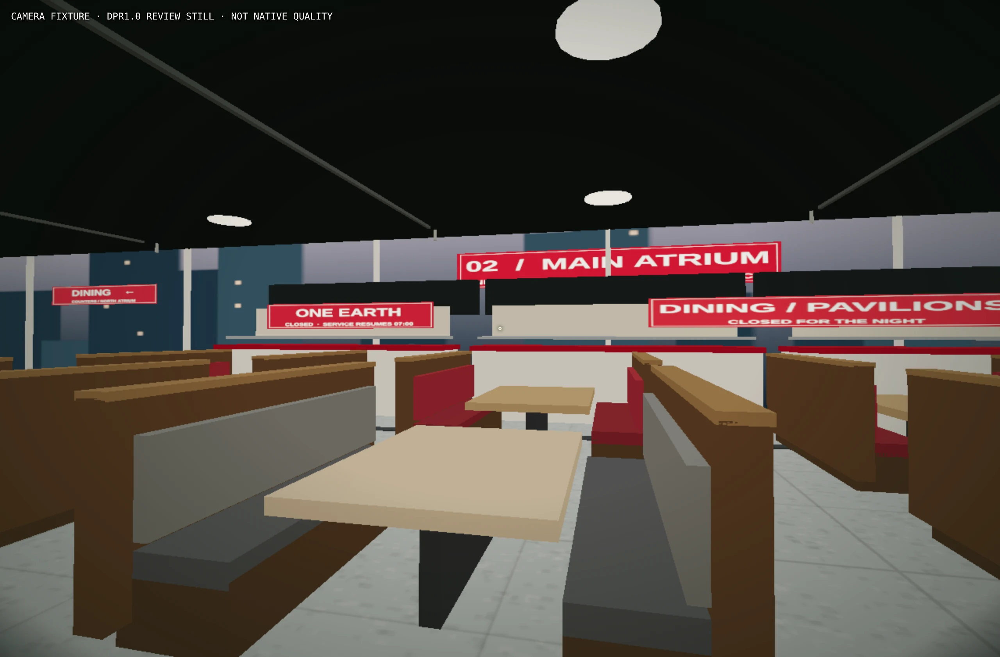 |
| E · IMG_1071.JPG; also IMG_1056.JPG | 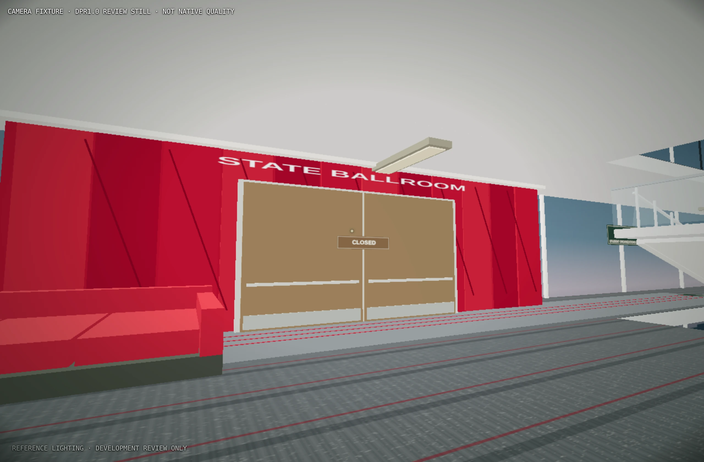 | 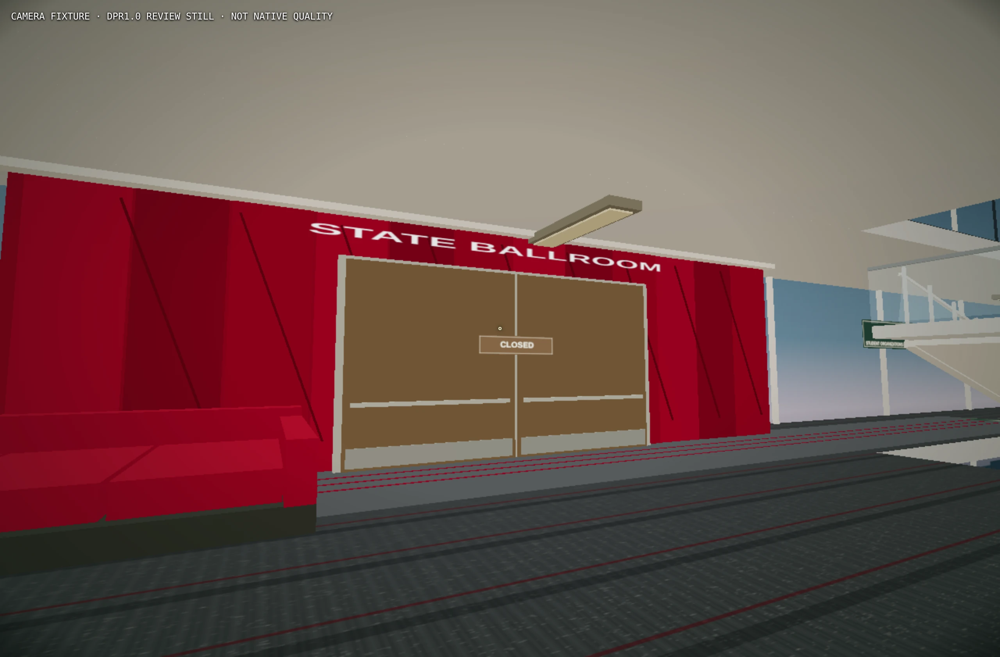 |
| F · IMG_1061.JPG; also IMG_1062.JPG | 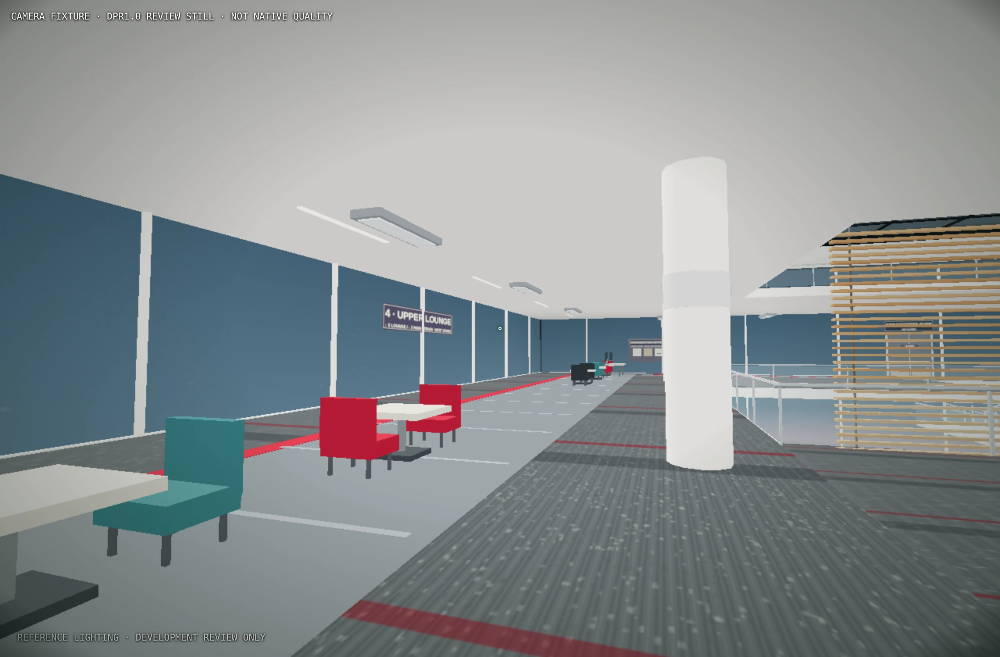 | 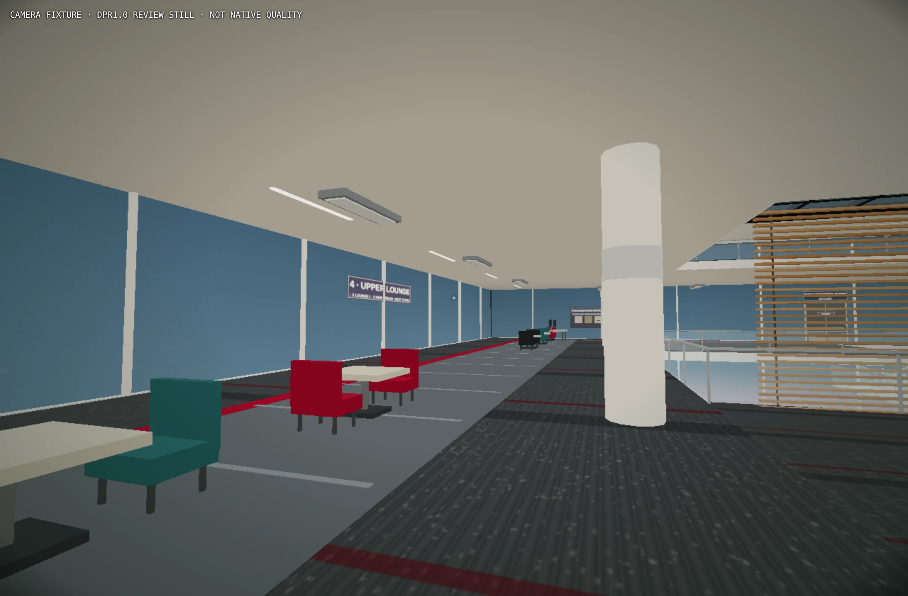 |

The two modes deliberately share geometry. Neutral lighting is a labeled Vite-development review mode, disabled in the production bundle. Story mode retains readable after-hours lighting, phone light and progression dimming. The story fixtures use a common unpowered state for controlled comparison, not the darkest late-game state.

| Checkpoint | Private reference filenames | Reconstructed features | Remaining simplification |
| --- | --- | --- | --- |
| A — signature atrium | IMG_1042.JPG, IMG_1043.JPG, IMG_1046.JPG | Two individually slatted suspended timber screens; three offset glass-railed balcony tiers; dark skylight lattice; round columns | Compact footprint; simplified screen suspension and roof structure; background overlook is not playable |
| B — white switchback | IMG_1047.JPG, IMG_1055.JPG | Opposing white flights, cross-landings, transparent guards and metal rails; camera follows the same polyline ascending and descending | Two compact U-return connections, not a measured reproduction of the actual stair network |
| C — lobby | IMG_1041.JPG, IMG_1045.JPG, IMG_1049.JPG | Rounded red C seating, gray flecked terrazzo, dark bands, red/white information counter and glazed entrance | Simplified storefront depth, reflected light and glossy finish; no expensive real-time reflections |
| D — Floor 2 dining | IMG_1034.JPG, IMG_1035.JPG, IMG_1037.JPG | Six wood/upholstered booths plus four table groups, counters, queue rail, dark soffit, round fixtures and café glazing | One authored dining cluster, fewer vendors and ceiling folds; furniture is modular low-poly |
| E — Floor 3 ballroom | IMG_1071.JPG, IMG_1056.JPG, IMG_1070.JPG | Red architectural volume and paneled seams, silver lettering, wood doors, gray/red corridor and theatre signage | Corridor remains compact/orthogonal rather than the exact photographed curvature |
| F — Floor 4 overlook | IMG_1061.JPG, IMG_1062.JPG, IMG_1060.JPG | Gray/red carpet, glass rail, numbered columns, red/black/turquoise furniture and small tables; north glass study-room fronts exist outside this camera | Fewer enclosed rooms and chairs; number on the foreground column faces away; distant public spaces are shallow authored facades |

### Controlled cameras

All use 68° vertical FOV and floor-relative eye height 1.67m. Coordinates are compact game-space values, not surveyed building coordinates. Complete native and diagnostic metadata is in [camera-evidence.json](docs/visuals/camera-evidence.json).

| Camera | Floor | Eye XYZ | Look-at XYZ |
| --- | --- | --- | --- |
| A | 2 | 0, 1.67, 8 | 0, 11, -6 |
| B | 2 | 4, 1.67, 13 | 14, 6, 2 |
| C | 2 | -2, 1.67, -2 | -2, 1.7, 19 |
| D | 2 | 0, 1.67, -10 | -2, 1.8, -19 |
| E | 3 | -12, 6.67, 8 | -21, 7.5, 3.7 |
| F | 4 | 19, 11.67, 12 | 7, 12.3, 16 |

## Verification boundaries

- **Gate A:** Actual browser fixtures verified the signature shell in both lighting modes. All 32 sampled cameras for four stair directions matched the shared path without observed slab/guard clipping. Subsequent physical ascents/descents also passed.
- **Full physical production route, dff57a56:** Fresh title/full intro/all progress false → entrance/directory/service notice → power → east stairs → actual cumulative phone-light board reveal → matching badge → west stairs → exit release → both physical descents → original doors → real victory. No gameplay position/progression injection. Phone pursuit/freeze, sampled furniture/void collisions and entity detours, checkpoint1 catch/retry, wrong power/release recovery, hints, pointer-lock recovery, pause/resume, replay and restart passed. Captured zero production exceptions, console errors or failed requests.
- **Timing/fairness:** Victory 07:27 game time, attempt03; about 14m02s wall time including intro, inspections, performance samples and two catches. One catch was deliberate; the other occurred while reading/capturing the Floor3 badge panel under the existing phone-open danger. The checkpoint restored correctly. This is **not** a blind-player pacing or slow-reader-safety guarantee. Checkpoint retries rewind the game clock.
- **Final visual-only follow-up, 5c927ea:** Corrected transparent sign alpha, removed the duplicate Ballroom header and culled off-floor decorative interiors. Colliders, anchors, store and controller did not change. Rechecked all six paired fixtures, number4 lettering and fresh-production entrance/directory/notice/phone/power-panel/movement recovery. The full route/lifecycle matrix was **not repeated** on this follow-up; its evidence remains explicitly dff57a56.
- **Automated checks on 5c927ea:** 26 tests, typecheck, lint, production build, diff check and production dependency audit passed (zero production vulnerabilities). The pre-existing large Three.js bundle warning remains. No repository CI checks are configured.
- **Still untested on the architecture revision:** detailed checkpoint2 death/retry and reading-buffer expiry/reset matrix, genuinely hidden-tab behavior, hardware-GPU FPS, speaker-output tuning, blind-human pacing and exhaustive collision edges. Earlier Talley coverage keeps its historical revision labels.
- **Privacy:** SHA-256 comparison against all 38 originals found none in `src`, `public` or `dist`. No JPEG/HEIC reference assets are present there. Only in-game screenshots are committed under `docs/visuals`; Vite does not copy them into the production bundle. The private reference package is git-ignored.
- Nothing merged or deployed. The Hill archive/tag remain untouched.

## Native renderer measurements — a remaining limitation

All samples used **ANGLE Vulkan SwiftShader software-low**, DPR0.45, 576×378 drawing buffer, CSS viewport1280×841 and at least10 seconds per sample. These are particular views, not whole-floor averages or laptop benchmarks.

| Revision / sample | FPS | p95 frame interval | Draw calls / triangles |
| --- | ---: | ---: | ---: |
| dff57a56 production · Floor2 booths | 34.29 | 50.0ms | 63 / 8,500 |
| dff57a56 production · Floor3 void edge | 25.26 | 66.6ms | 162 / 13,020 |
| dff57a56 production · Floor4 northeast ring | 16.25 | 133.3ms | 203 / 15,198 |
| 5c927ea Vite camera fixture · same Floor4 northeast camera | 16.84 | 83.3ms | 181 / 12,770 |

The final sample has fewer draws, but it is a **development fixture versus an earned production state**: progression lighting/development overhead differ, so this is not a strict causal FPS comparison. **Floor4 does not meet a 30-FPS target here.** Geometry remains playable but visibly stuttery on the VM. Hardware acceleration must be tested separately; do not infer its performance from this renderer.

Native-quality examples, without the diagnostic DPR override:

| Atrium | Dining | Upper overlook |
| --- | --- | --- |
| 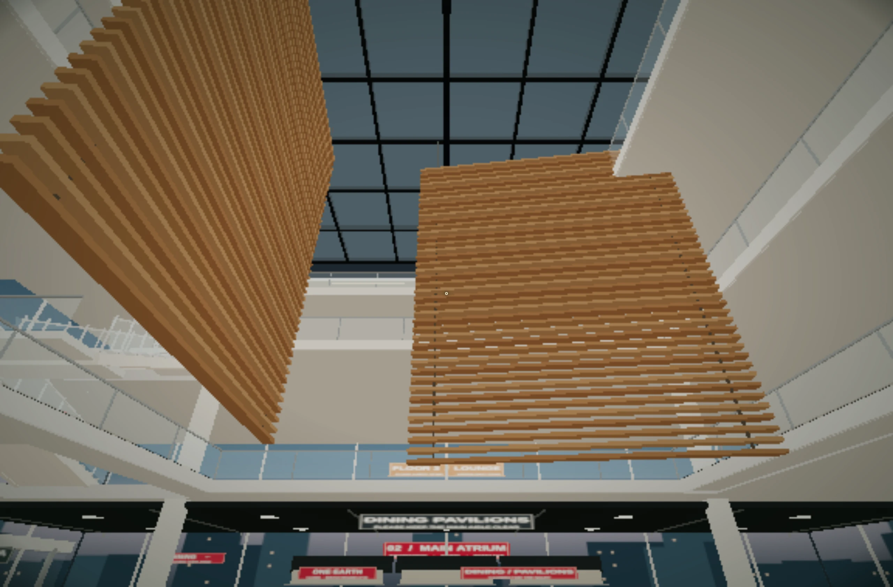 | 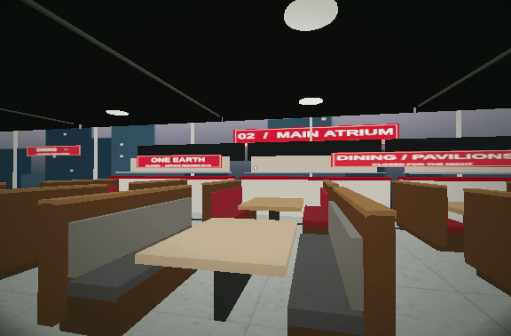 |  |

## What still needs refinement

This is a substantial photo-informed reconstruction, **not a photo-exact or measured replica**. The roof/atrium proportions, screen suspension, true corridor curvature, vendor variety, furnishing density, rail hardware and reflective material response remain simplified. Public detail is mounted for the active floor to bound rendering cost; the atrium shell, screens, balcony tiers and stairs remain visible across floors. The third upper overlook is architectural background, not an additional playable story floor. Further artistic fidelity and software-renderer performance work are appropriate before calling the environment finished to reference fidelity.
